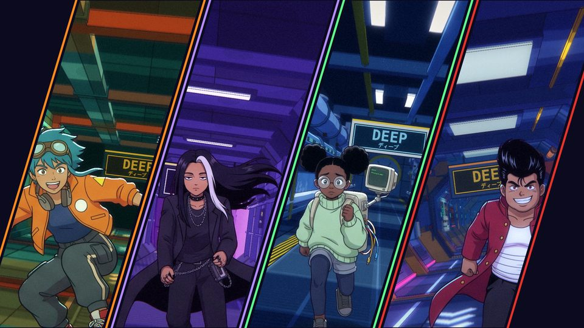
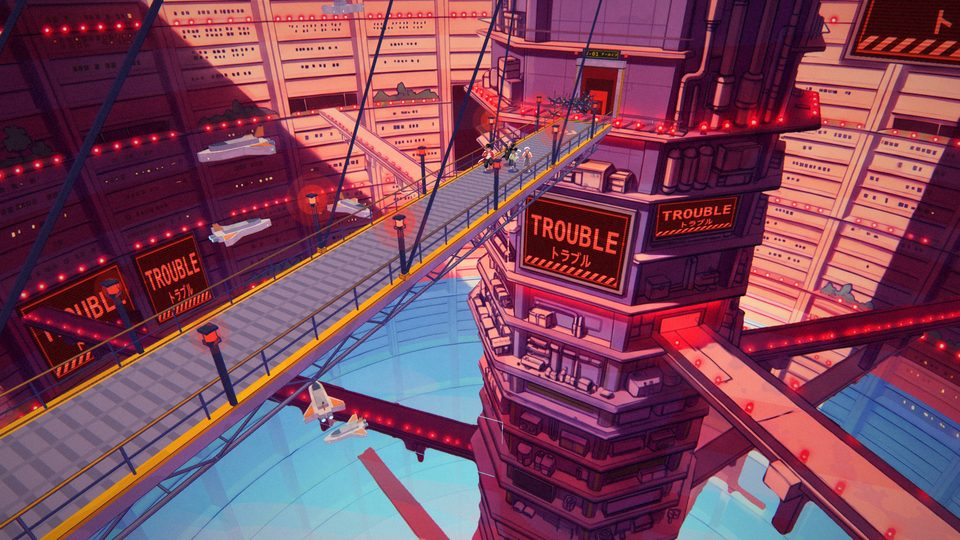
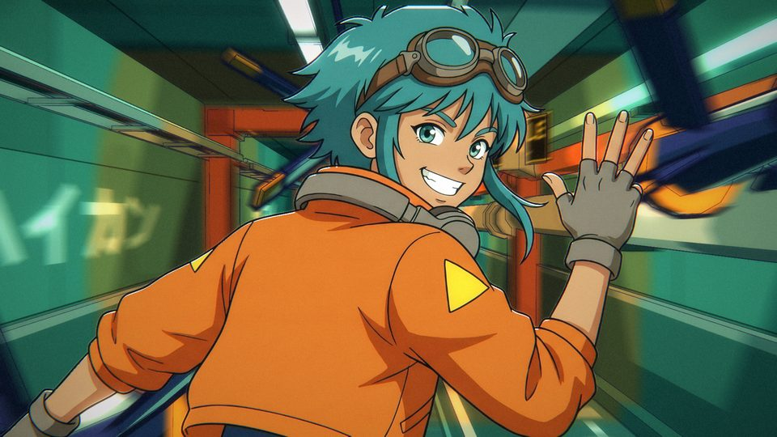
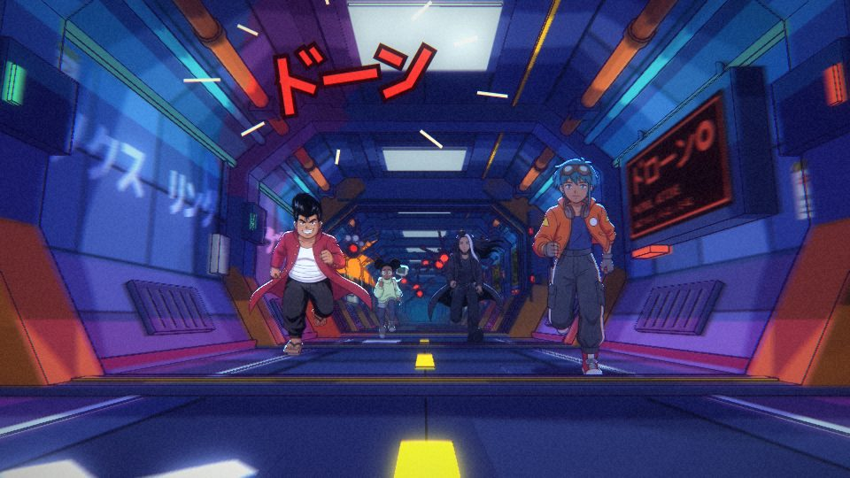
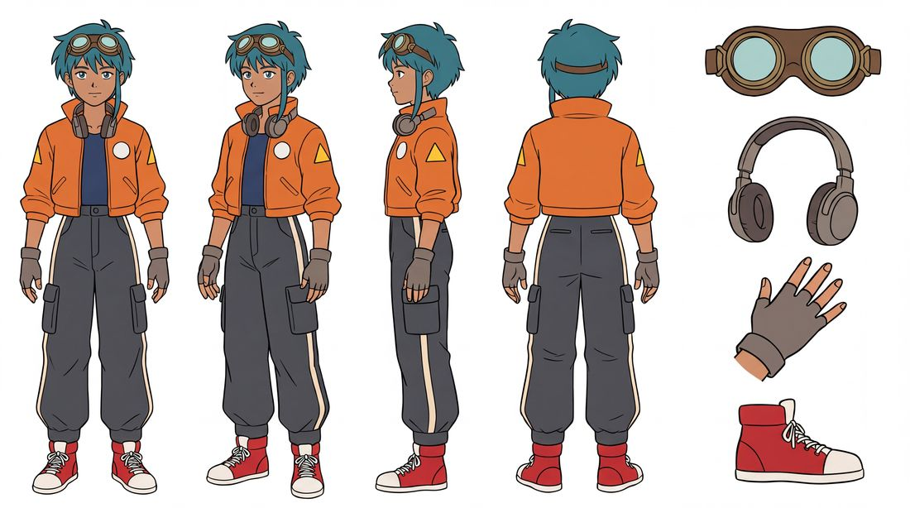

# Trouble: a music video rendered from code, and the kit it was made with

A 2 minute 45 second anime-style music video, "Trouble", rendered frame by frame from code in headless Chrome. Four
kids break out of a space station to a song: the characters are drawings hung on a 3D skeleton, the station is
modelled and painted sets whose lights and machines are wired to the song's instruments, and every cut and hit sits
on a measured beat, kick or sung word.

Everything used to make it is here, and it is meant to be forked: point your coding agent at a fork, give it a song,
and reuse the cast, the sets and the tools to make a film of your own.



| | |
|---|---|
|  |  |

## Five minutes to a clip of your own

You need **Node 20+**, **Python 3.10+** and **Google Chrome or Chromium** already installed. Nothing else is
installed system-wide, no browser is downloaded, and no API key is needed to render.

```sh
git clone --depth 1 https://github.com/dglazkov/trouble-video.git    # a 1.1 GB download: see "What is big" below
cd trouble-video
npm run setup      # node_modules, a Python .venv with requirements.txt, then the doctor
npm run hello      # renders shots/hello.js -> out/hello.mp4: 10 s of the cast on the demo song (42 s on a laptop GPU)
npm run starter -- path/to/your_song.mp3     # the same thing cut to YOUR song -> out/your_song.mp4
```



`npm run starter` measures your audio file (beats, bar lines, sections, an estimate of the kick drum), picks the
stretch with the most kicks, writes `stories/your_song/starter.js`, checks that its cuts and hits are on the music,
and renders it. In that clip the cast run with a foot down on every beat, a drone is blown out of the pack on the
first kick of each bar, and the two shots are cut on a bar line. The shot file it writes is about 80 commented lines:
it is the example to grow from. If you have stems of your song (one audio file per instrument), add `--stems DIR` and
the kick is measured from the drum stem instead of estimated.

No GPU? Add `--software` (`npm run hello -- --software`): Chrome's software renderer works, at about a seventh of the
speed. `npm run doctor` says what a machine is missing in plain words.

## Watch or render the original film

```sh
node render.mjs shots/slice.js     # one section (14 s of film): out/slice.mp4
npm run film                       # all of it: shots/film.js -> out/film.mp4, 3956 frames at 1920x1080 (29 minutes)
```

The ten sections are `open descent gantry slice wins core boom breakdown reunion fall` (each `shots/NAME.js`).
A section takes two to five minutes on a laptop GPU; the whole film took 29 minutes here (Intel integrated
graphics, 2.9 frames a second) and `out/film.mp4` is 1.4 GB (near-lossless H.264; re-encode it to share it).

## What you can reuse

- **The cast** (`kits/`): Juno, Tane, Ife and Noor, each with a locked design, a run cycle from several sides, other
  actions, dozens of one-off drawings and close-ups, and the logs of what was tried; plus a crowd of 40 bystanders.
  [docs/cast.md](docs/cast.md) shows every drawing and how to add more.
- **The engine** (`engine/`): the skeleton and poses, the stage that puts drawings into a 3D set and photographs
  them, edits, the song as a function of the frame, drawn explosions and sound-effect words, and two checks: `marks`
  (is every cut and hit on the music?) and `motion` (do feet slide, do drawings pop?).
- **The sets and machines** (`sets/`, `machines/`): ten places on the station, drones and a boss machine, all wired
  to the song's stems by name, so they play any song you measure.
- **The drawing pipeline** (`pipeline/`): how a new action or a new character is laid out from the skeleton, painted
  by an image model, checked by data, cut and registered. This part needs a Gemini API key; nothing else does.
- **The song tools** (`analysis/`): `analysis/song.py` measures any audio file into the form the engine reads.

What is *this film* rather than the kit: `shots/` (its 137 shot files and ten section edits), `audio.wav` and
`analysis/*.json` (the demo song and its measurements), `subs/`, `docs/lyrics.md`, `docs/japanese.md`.

## The cast at a glance

| | Who | Moves like | Colour |
|---|---|---|---|
| **Juno** | 15, the rider: teal hair, flight goggles, orange jacket, a homemade hoverboard | an athlete: light and fast | orange |
| **Tane** | 16, the muscle: pompadour, long red coat, wooden sandals, a grin | a bull: upright, chest out, heavy | red |
| **Ife** | 14, the engineer: round glasses, a CRT computer worn as a backpack | scurries: short quick steps | green |
| **Noor** | 16, the cool one: waist-length black hair with a white streak, a cassette player | lopes: long unhurried strides | violet |



## Where to go next

- [docs/story.md](docs/story.md): from a song to a finished film, step by step.
- [docs/song.md](docs/song.md): measuring a song; stems and what you lose without them.
- [docs/shots.md](docs/shots.md): what a shot file is, annotated; characters, plates and close-ups in a shot.
- [docs/sets.md](docs/sets.md): the places that exist, and how to make one.
- [docs/lettering.md](docs/lettering.md): sound-effect words and signs.
- [docs/checking.md](docs/checking.md): marks, motion, and looking at frames properly.
- [docs/cast.md](docs/cast.md): the cast bible, and recipes for new drawings and new characters.
- [CLAUDE.md](CLAUDE.md) (the same file as AGENTS.md points to): the guide for an AI agent working in a fork,
  with the rules this project paid for.

`npm test` runs the checks a fork should keep green (about a minute; `npm test -- --no-render` in 20 s).

## Platforms

Developed and verified on Linux (Ubuntu 26.04, Chrome 156, Node 22, Python 3.14) with Intel integrated graphics, and on
the same machine with Chrome's software renderer. macOS and Windows paths for Chrome are looked for but **have not
been run**; on Windows use WSL or expect to adapt `scripts/setup.sh`. The sets' Latin signage uses the system font
DejaVu Sans Mono and falls back to another monospace face without it.

## What is big, and why

A clone is a 1.1 GB download and 2.1 GB on disk (the files, and git's packed copy of them). `--depth 1` skips the
history, but most of the size is in the current files: `kits/` holds every generated sheet and close-up as it came from the image model (about 870 MB of
JPEG and PNG, each with a sidecar `.json` of its prompt and references) beside the cut drawings the film actually
loads (about 60 MB of WebP). Those sources are part of what is shared: they are the record of how each drawing was
asked for.

## Licences

Three different things are in this repository, under three different terms:

| What | Where | Terms |
|---|---|---|
| **Code** | everything that is not listed below | [Apache-2.0](LICENSE) |
| **Characters and art**: the cast, the crowd, every drawing, design and painted background, and the pictures in the docs | `kits/`, `art/` (except `art/gen.py`), `sets/*/`, `machines/warden/`, `docs/img/`, `test/ref/` | [CC BY 4.0](LICENSE-ART.md): reuse and remix, commercially too, with credit to **Dimitri Glazkov ("Trouble" project)** and a link to this repository |
| **The song** and its words | `audio.wav`, the lyric text in `analysis/lyrics.json`, `subs/`, `docs/lyrics.md` | [Demo only, all rights reserved](LICENSE-SONG.md): it is here so the original film renders. Bring your own music |
| The font Dela Gothic One | `fonts/` | [SIL OFL 1.1](fonts/OFL.txt) |

## How it was made

The film was built in one session of about 22 hours, from the first message to "honestly, it's perfect" (91 commits
by then; 105 once the repository had been made forkable), by an AI coding agent, Claude, directed by Dimitri Glazkov,
who chose the story, watched each section and sent it back until it was right. The song is his. There is a making-of
video, cut from the session's own record: see "The making-of" below.

The drawings were **generated, not drawn by hand**: every character sheet, close-up and painted background was made
with Google's Gemini image model ("Nano Banana 2") from prompts written for this project, over layouts rendered from
the project's own 3D skeleton and sets, and then selected, edited, colour-graded, keyed, cut and composited by the
pipeline in this repository. The kits' logs record 379 character images generated, of which 137 were thrown away: 98 by automatic checks (a limb
off its layout, a colour off the design) and 39 by a person looking. Counting what the logs do not cover (the first
tests and designs, the crowd, the painted backgrounds, the boss), about 480 to 500 images were generated in all; that
total is an estimate, not a logged figure. Every
take is kept in `kits/*/source/` and `kits/*/closeup/` with its prompt beside it, and `kits/*/log.jsonl` says what
was rejected and why. Nothing is generated when the film renders: a render is deterministic code over frozen art.

`bakeoff/` holds the first day's experiments (Blender against the browser, a puppet made of separately drawn parts
that was rejected); it is kept as history and nothing uses it.

## The making-of

`stories/makingof/` is a four-minute making-of, rendered by the same engine as a story of its own: eleven chapters of
quotes from the session, the footage of each stage (the bake-off, the rejected puppet, the first whole drawings, the
owner's screenshots and their fixes) and a running tally of who had which idea, cut to the song rebuilt from its stems.

```sh
npm run film                                  # the making-of shows passages of the film from out/film/frames/
npm run makingof                              # stories/makingof/film.js -> out/makingof/makingof.mp4 (6000 frames)
node stories/makingof/check.mjs               # its quotes against the transcript, its numbers against the stats
```

Every word on screen is in `stories/makingof/ledger.json`, with who said it and when; `script.js` says when each is
shown, in frames read from the music's measurements; `footage/` (46 MB of WebP) is the footage that is not the film
itself, at the size it is shown. The terminal in it is a recreation from the transcript: there was no screen recording.

## Credits

Direction, story, song: Dimitri Glazkov. Code, staging and pipeline: Claude (Anthropic), working as a coding agent.
Images: Google Gemini image models, from this project's prompts. Display font: Dela Gothic One by the Dela Gothic Project Authors (SIL OFL).
Rendering: three.js and Chrome, driven by playwright-core. Audio analysis: librosa and faster-whisper.
