# The cast

Four characters and a crowd, with every drawing their kits hold. The tables and pictures below are generated from
the kits by `npm run cast` (`scripts/cast_doc.py`); the prose is written by hand. The characters and all the
pictures are CC BY 4.0: credit "Trouble" by Dimitri Glazkov ([LICENSE-ART.md](../LICENSE-ART.md)).

Words used here: a **cel** is one whole-figure drawing in one pose from one view. An **action** is a fixed set of
poses; a kit holds a cel per pose per **view**. A **hero** drawing was made for one shot's camera on one frame. A
**plate** is a single picture on a key colour laid over the frame whole (a close-up). `kit.json` is the manifest the
engine loads; `character.json` is the design in words, colours and proportions, which the painter and the checks read.

All drawings were generated with Google's Gemini image model over layouts rendered from the skeleton, then checked,
graded, keyed and cut by `pipeline/`. Each kit's `source/` and `closeup/` keep every take with its prompt, and
`log.jsonl` says which were rejected and why.

How to use them in a shot: [shots.md](shots.md). What each can do **without any new drawing**:

| | run: front | run: side | run: 3/4 front, 3/4 back | run from above | idle | slide (side) | Own actions | Hero drawings | Plates |
|---|---|---|---|---|---|---|---|---|---|
| Juno | yes | yes | yes | yes | yes (3 views) | yes | `ride`, `leap` (on her board), `desc_slide` (down a handrail) | 28 | 13 |
| Tane | yes | yes | — | yes | — | yes | `charge` (a shoulder charge), `desc_vault` (over a stair rail) | 20 | 23 |
| Ife | yes | yes | — | yes | — | yes | `desc_steps` (pattering down stairs) | 6 | 21 |
| Noor | yes | yes | — | yes | — | yes | a ten-drawing walk (as hero drawings `rw_*`, `ro_*`) | 54 | 16 |

Anything else (a walk for the others, sitting, talking, another angle) is a new drawing: recipes at the end.

---

## Juno

**Who:** 15, the rider and the one who goes first. Teal hair with one long lock by her left ear, brass flight goggles
pushed up, headphones round her neck, an orange cropped flight jacket with a yellow triangle on each sleeve, red
high-tops. She rides a hoverboard she welded herself. **Moves** like an athlete: light, fast, eyes ahead; the run
the first kit was painted over is hers. **Colour:** orange on teal (`#ff8a1e`). **In the film:** leaps the gap in
the market on her board, loses the swarm at a blast door, salutes.

<!-- generated:juno -->
Body: 1.6 m tall, 6.3 heads. Design locked in `kits/juno/design/model_5.jpg`; palette skin `#cc8e6c`, hair `#3d7683`, jacket `#dd7135`, shirt `#364364`, trousers `#4f4f55`, stripe `#f1d6bb`, glove `#847269`, shoe `#bd3235` ….

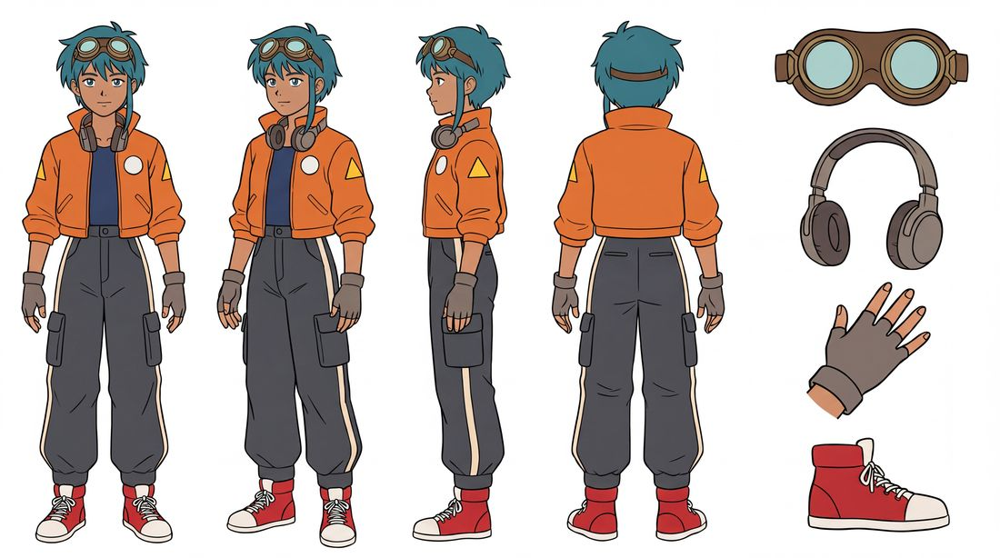

**Actions** (cels on the skeleton; a shot asks `{ who, action, phase, view }`):

| Action | View | Drawings | What it is |
|---|---|---|---|
| `run` | left side (90°) `side` | 8 | the run cycle: 8 drawings, looped |
| `run` | three-quarter front (45°) `front34` | 8 | the run cycle: 8 drawings, looped |
| `run` | three-quarter back (135°) `back34` | 8 | the run cycle: 8 drawings, looped |
| `run` | front (0°) `front` | 8 | the run cycle: 8 drawings, looped |
| `idle` | three-quarter front (45°) `front34` | 1 | standing at ease: 1 drawing |
| `idle` | three-quarter back (135°) `back34` | 1 | standing at ease: 1 drawing |
| `idle` | left side (90°) `side` | 1 | standing at ease: 1 drawing |
| `leap` | three-quarter back (135°) `back34` | 2 | Juno's leap on the board: launch, apex |
| `runtop` | from above `top` | 4 | the run seen from straight above: 4 drawings, looped |
| `ride` | three-quarter back (135°) `back34` | 3 | Juno on her hoverboard: banked left, level, banked right |
| `desc_slide` | left side (90°) `side` | 3 | Juno sliding down a handrail on her feet: 3 drawings |
| `gant_slide` | left side (90°) `side` | 2 | the slide under a closing door, feet first: 2 drawings |

**Hero drawings** (28; one-off drawings for one shot's camera; a shot asks `hero: "name"`):

| Name | Drawn for | Pose it was laid out from |
|---|---|---|
| `leap_launch` | `shots/slice_leap.js` frame 7 | `leap` drawing 0 |
| `leap_rise` | `shots/slice_leap.js` frame 13 | `leap` drawing 0 |
| `leap_apex` | `shots/slice_leap.js` frame 26 | `leap` drawing 1 |
| `ride_left` | `shots/slice_ride.js` frame 54 | `ride` drawing 0 |
| `ride_mid` | `shots/slice_ride.js` frame 86 | `ride` drawing 1 |
| `ride_right` | `shots/slice_ride.js` frame 24 | `ride` drawing 2 |
| `frozen` | `shots/open.js` frame 65 | `caught` drawing 0 |
| `started` | `shots/open.js` frame 200 | `caught` drawing 1 |
| `backing` | `shots/open.js` frame 355 | `caught` drawing 2 |
| `backed` | `shots/open.js` frame 359 | `caught` drawing 3 |
| `heap` | `shots/desc_ding.js` frame 34 | `desc_heap` drawing 1 |
| `land` | `shots/wins.js` frame 8 | `wins_juno` drawing 0 |
| `skid` | `shots/wins.js` frame 14 | `wins_juno` drawing 1 |
| `lookback` | `shots/wins.js` frame 24 | `wins_juno` drawing 2 |
| `sit` | `shots/wins.js` frame 361 | `wins_juno` drawing 5 |
| `goggles` | `shots/wins.js` frame 379 | `wins_juno` drawing 6 |
| `salute` | `shots/wins.js` frame 389 | `wins_juno` drawing 7 |
| `front_left` | `shots/wins.js` frame 238 | `ride` drawing 0 |
| `front_mid` | `shots/wins.js` frame 242 | `ride` drawing 1 |
| `front_right` | `shots/wins.js` frame 248 | `ride` drawing 2 |
| `drop` | `shots/wins.js` frame 316 | `wins_juno` drawing 3 |
| `flat` | `shots/wins.js` frame 323 | `wins_juno` drawing 4 |
| `under_drop` | `shots/wins_under.js` frame 2 | `wins_juno` drawing 3 |
| `under_flat` | `shots/wins_under.js` frame 8 | `wins_juno` drawing 4 |
| `shades` | `shots/wins.js` frame 389 | `wins_juno` drawing 7 |
| `reun_side_a` | `shots/reun_p_juno.js` frame 44 | `ride` drawing 1 |
| `reun_side_b` | `shots/reun_p_juno.js` frame 62 | `ride` drawing 0 |
| `reun_side` | `shots/reun_meet_edit.js` frame 12 | `ride` drawing 1 |

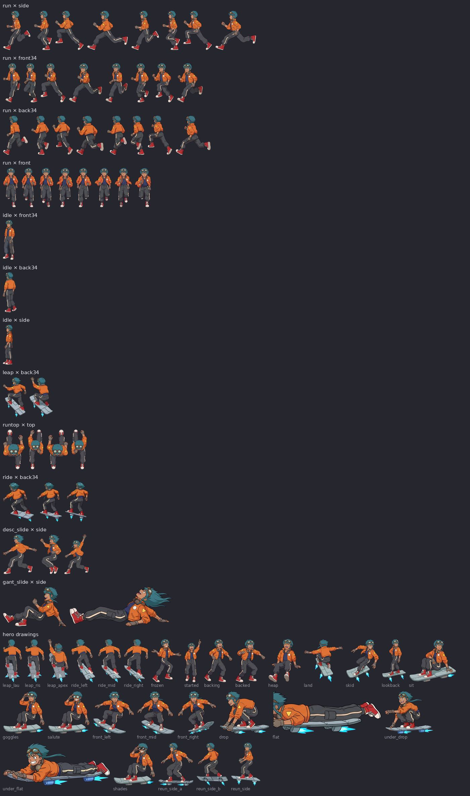

**Close-ups and plates** (`kits/juno/closeup/`; single drawings on the key colour, laid over a set whole). A plate with more than one of the cast is filed under each of them. Takes include rejected ones and expression edits; the sidecar `.json` beside each has its prompt.

| Plate | Takes | Kind | Shots that name it |
|---|---|---|---|
| `brk_face` | 9 | plate | `breakdown.js` |
| `brk_go` | 2 | plate | — |
| `fall_face_juno` | 4 | plate | — |
| `fall_side_juno` | 6 | plate | — |
| `gant_duck` | 5 | plate | `gant_duck.js`, `gantry.js` |
| `open_face` | 5 | close-up | — |
| `reun_eyes` | 1 | close-up | — |
| `reun_juno_go` | 1 | plate | `reun_fight.js` |
| `reun_juno_taunt` | 1 | plate | `reun_fight.js` |
| `reun_skid_b` | 1 | plate | — |
| `reun_skid_juno` | 1 |  | `reun_meet.js` |
| `slice_run` | 1 | close-up | `gant_out.js`, `slice.js`, `slice_faces.js`, `slice_run.js` |
| `wins_count` | 3 | plate | `wins.js`, `wins_count.js` |

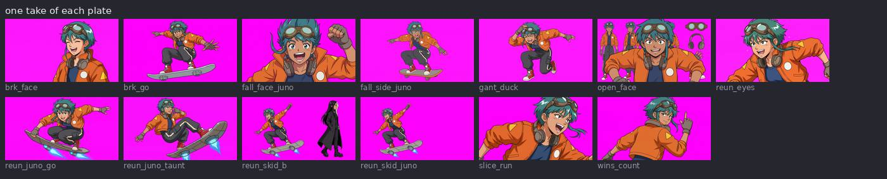

Also `kits/juno//`: drawings cut from plates for one section's shots (pipeline/sprites.py), 0 files.
<!-- /generated:juno -->

## Tane

**Who:** 16, the muscle, and cheerful about it. Stocky with a round belly, a tall black pompadour, a long dark-red
coat worn open over a white belly wrap, bare feet in wooden geta sandals, and a grin that shows his teeth in every
drawing. **Moves** like a bull: upright, chest and belly out, elbows wide, heavy on his feet. **Colour:** red
(`#e8242c`). **In the film:** goes through a shutter shoulder first and leaves a hole his own shape; takes three
drones apart with a length of pipe.

<!-- generated:tane -->
Body: 1.7 m tall, 6.1 heads. Design locked in `kits/tane/design/model_1.png`; palette skin `#d39371`, skinshade `#a2614d`, coat `#9d2a37`, coatshade `#651322`, white `#f1ecee`, wrapshade `#cfc4d2`, trousers `#2e2d30`, wood `#b8794f` ….

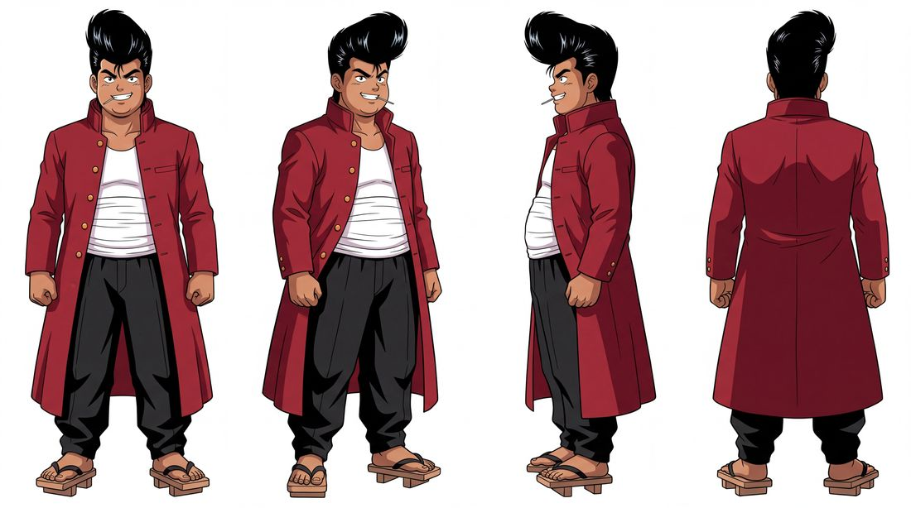

**Actions** (cels on the skeleton; a shot asks `{ who, action, phase, view }`):

| Action | View | Drawings | What it is |
|---|---|---|---|
| `run` | front (0°) `front` | 8 | the run cycle: 8 drawings, looped |
| `run` | left side (90°) `side` | 8 | the run cycle: 8 drawings, looped |
| `charge` | left side (90°) `side` | 2 | Tane's shoulder charge: wind-up, impact |
| `runtop` | from above `top` | 4 | the run seen from straight above: 4 drawings, looped |
| `desc_vault` | left side (90°) `side` | 3 | Tane vaulting the stair rails, flight to flight: 3 drawings |
| `gant_slide` | left side (90°) `side` | 2 | the slide under a closing door, feet first: 2 drawings |

**Hero drawings** (20; one-off drawings for one shot's camera; a shot asks `hero: "name"`):

| Name | Drawn for | Pose it was laid out from |
|---|---|---|
| `frozen` | `shots/open.js` frame 65 | `caught` drawing 0 |
| `started` | `shots/open.js` frame 200 | `caught` drawing 1 |
| `backing` | `shots/open.js` frame 355 | `caught` drawing 2 |
| `backed` | `shots/open.js` frame 359 | `caught` drawing 3 |
| `heap` | `shots/desc_ding.js` frame 34 | `desc_heap` drawing 1 |
| `cornered` | `shots/wins.js` frame 49 | `wins_tane` drawing 0 |
| `stamp` | `shots/wins.js` frame 89 | `wins_tane` drawing 1 |
| `windup` | `shots/wins.js` frame 99 | `wins_tane` drawing 2 |
| `contact` | `shots/wins.js` frame 107 | `wins_tane` drawing 3 |
| `follow` | `shots/wins.js` frame 111 | `wins_tane` drawing 4 |
| `ready` | `shots/wins.js` frame 132 | `wins_tane` drawing 5 |
| `catch` | `shots/wins.js` frame 146 | `wins_tane` drawing 6 |
| `weigh` | `shots/wins.js` frame 162 | `wins_tane` drawing 7 |
| `coil` | `shots/wins.js` frame 178 | `wins_tane` drawing 8 |
| `slam` | `shots/wins.js` frame 186 | `wins_tane` drawing 9 |
| `rise` | `shots/wins.js` frame 200 | `wins_tane` drawing 10 |
| `rest` | `shots/wins.js` frame 216 | `wins_tane` drawing 11 |
| `burst` | `shots/slice_tane.js` frame 55 | `slice_burst` drawing 0 |
| `land` | `shots/slice_tane.js` frame 59 | `slice_burst` drawing 1 |
| `look` | `shots/slice_tane.js` frame 65 | `slice_burst` drawing 2 |

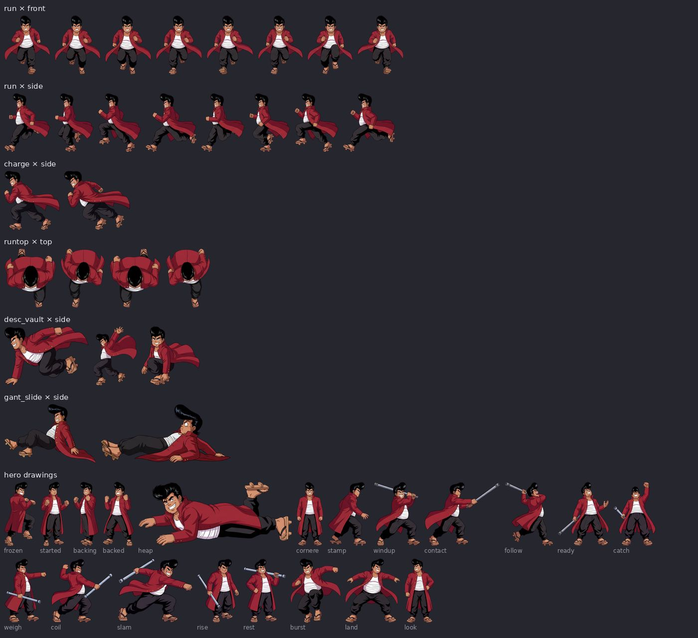

**Close-ups and plates** (`kits/tane/closeup/`; single drawings on the key colour, laid over a set whole). A plate with more than one of the cast is filed under each of them. Takes include rejected ones and expression edits; the sidecar `.json` beside each has its prompt.

| Plate | Takes | Kind | Shots that name it |
|---|---|---|---|
| `brk_back` | 1 | plate | — |
| `brk_face` | 9 | plate | `breakdown.js` |
| `brk_go` | 1 | plate | — |
| `fall_above` | 4 | plate | — |
| `fall_below` | 4 | plate | `fall.js` |
| `fall_face_tane` | 3 | plate | — |
| `fall_hang` | 8 | plate | `fall.js` |
| `fall_props` | 2 | plate | — |
| `fall_ring` | 11 | plate | `fall.js`, `fall_dark.js` |
| `fall_side_tane` | 5 | plate | — |
| `open_face` | 3 | close-up | — |
| `reun_backs` | 1 | plate | `reun_fight.js` |
| `reun_eyes` | 1 | close-up | — |
| `reun_faces` | 7 | plate | — |
| `reun_grin` | 2 | plate | `reun_fight.js` |
| `reun_ready` | 1 | plate | `reun_fight.js` |
| `reun_skid` | 1 |  | — |
| `reun_skid_a` | 1 | plate | `reun_meet.js` |
| `reun_tane_charge` | 1 | plate | `reun_fight.js` |
| `reun_tane_hit` | 1 | plate | `reun_fight.js` |
| `reun_tane_leap` | 1 | plate | `reun_fight.js` |
| `slice_run` | 1 |  | `gant_out.js`, `slice.js`, `slice_faces.js`, `slice_run.js` |
| `wins_crack` | 2 | plate | `wins.js`, `wins_crack.js` |

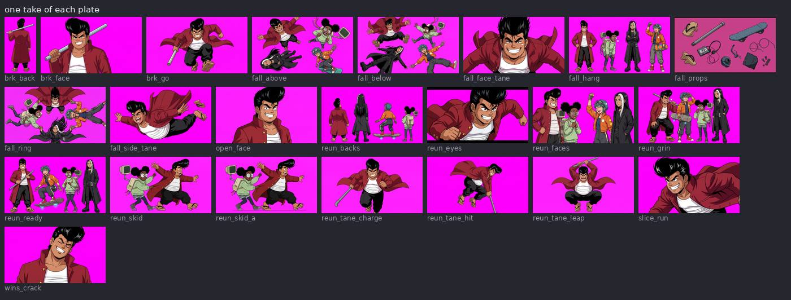

Also `kits/tane//`: drawings cut from plates for one section's shots (pipeline/sprites.py), 0 files.
<!-- /generated:tane -->

## Ife

**Who:** 14, the engineer, the smallest of the four (five and a half heads tall) and the worrier. Two round afro
puffs, enormous round glasses, an oversized pale-green jumper, and a boxy beige computer worn as a backpack with a
small green CRT on a jointed arm over her shoulder. **Moves** in a scurry: short quick steps, leaning in, fists
pumping high. **Colour:** green (`#3dff8a`). **In the film:** plugs into the coolant plant and blows it up on a
countdown.

<!-- generated:ife -->
Body: 1.42 m tall, 5.5 heads. Design locked in `kits/ife/design/model_1.png`; palette skin `#885446`, skinshade `#5d3a33`, jumper `#b7cca0`, jumpershade `#7e8b6e`, leggings `#39384e`, shorts `#929293`, shortsshade `#656366`, shoe `#5c5756` ….

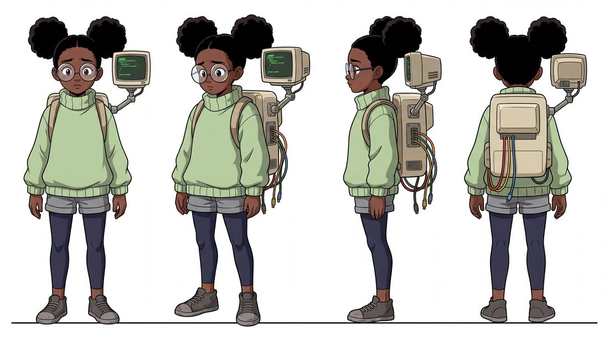

**Actions** (cels on the skeleton; a shot asks `{ who, action, phase, view }`):

| Action | View | Drawings | What it is |
|---|---|---|---|
| `run` | front (0°) `front` | 8 | the run cycle: 8 drawings, looped |
| `run` | left side (90°) `side` | 8 | the run cycle: 8 drawings, looped |
| `runtop` | from above `top` | 4 | the run seen from straight above: 4 drawings, looped |
| `gant_slide` | left side (90°) `side` | 2 | the slide under a closing door, feet first: 2 drawings |
| `desc_steps` | left side (90°) `side` | 4 | Ife taking every stair: a patter of 4 drawings |

**Hero drawings** (6; one-off drawings for one shot's camera; a shot asks `hero: "name"`):

| Name | Drawn for | Pose it was laid out from |
|---|---|---|
| `frozen` | `shots/open.js` frame 65 | `caught` drawing 0 |
| `started` | `shots/open.js` frame 200 | `caught` drawing 1 |
| `backing` | `shots/open.js` frame 355 | `caught` drawing 2 |
| `backed` | `shots/open.js` frame 359 | `caught` drawing 3 |
| `fall` | `shots/desc_ding.js` frame 29 | `desc_heap` drawing 0 |
| `heap` | `shots/desc_ding.js` frame 34 | `desc_heap` drawing 1 |

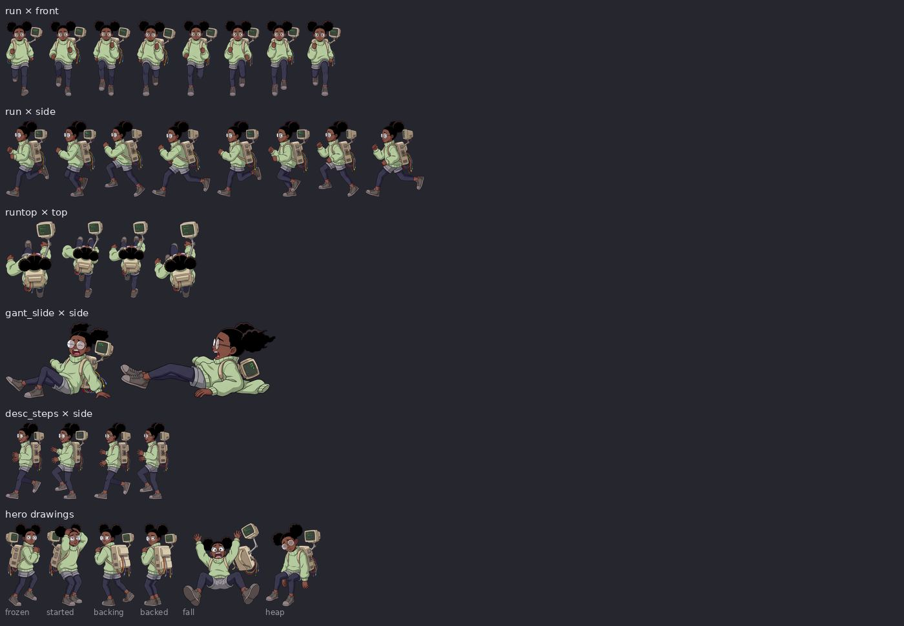

**Close-ups and plates** (`kits/ife/closeup/`; single drawings on the key colour, laid over a set whole). A plate with more than one of the cast is filed under each of them. Takes include rejected ones and expression edits; the sidecar `.json` beside each has its prompt.

| Plate | Takes | Kind | Shots that name it |
|---|---|---|---|
| `boom_back` | 1 | plate | — |
| `boom_collar` | 1 | plate | — |
| `boom_crt` | 1 | plate | — |
| `boom_duck` | 2 | plate | — |
| `boom_eyes` | 2 | plate | — |
| `boom_face` | 5 | plate | `boom.js` |
| `boom_peek` | 1 | plate | — |
| `boom_plug` | 2 | plate | — |
| `boom_push` | 4 | plate | — |
| `boom_skid` | 2 | plate | — |
| `brk_face` | 6 | plate | `breakdown.js` |
| `brk_go` | 1 | plate | — |
| `fall_face_ife` | 3 | plate | — |
| `fall_glass` | 2 | plate | `fall.js` |
| `fall_side_ife` | 5 | plate | — |
| `gant_trip` | 2 | plate | — |
| `open_face` | 4 | close-up | — |
| `reun_eyes` | 1 | close-up | — |
| `reun_ife_box` | 1 | plate | `reun_fight.js` |
| `reun_ife_key` | 1 | plate | `reun_fight.js` |
| `slice_run` | 1 |  | `gant_out.js`, `slice.js`, `slice_faces.js`, `slice_run.js` |

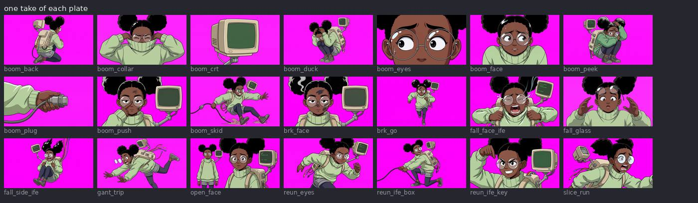

Also `kits/ife//`: drawings cut from plates for one section's shots (pipeline/sprites.py), 0 files.
<!-- /generated:ife -->

## Noor

**Who:** 16, androgynous (they/them in the prompts), the tallest (seven and a half heads) and the calm one.
Waist-length straight black hair with one white streak on their left, half-lidded deadpan eyes, a long black coat,
platform boots, a cassette player clipped on their left hip. **Moves** in a lope: long unhurried strides, arms low.
**Colour:** violet and white (`#a45cff`). **In the film:** presses PLAY and drifts through the zero-gravity core;
walks out of the last explosions and over the wreck. The streak and the player are on their LEFT: a mirrored
drawing puts them on the right, so stage Noor with the camera on their left when either shows.

<!-- generated:noor -->
Body: 1.82 m tall, 7.5 heads. Design locked in `kits/noor/design/model_2.png`; palette skin `#cf987a`, skinshade `#a8705a`, coat `#312d34`, coatshade `#1c1a20`, white `#e5dfe0`, silver `#969495`, grey `#59575a`.

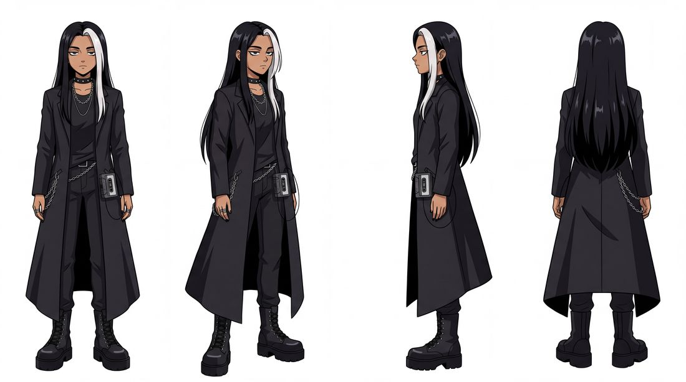

**Actions** (cels on the skeleton; a shot asks `{ who, action, phase, view }`):

| Action | View | Drawings | What it is |
|---|---|---|---|
| `run` | front (0°) `front` | 8 | the run cycle: 8 drawings, looped |
| `run` | left side (90°) `side` | 8 | the run cycle: 8 drawings, looped |
| `runtop` | from above `top` | 4 | the run seen from straight above: 4 drawings, looped |
| `gant_slide` | left side (90°) `side` | 2 | the slide under a closing door, feet first: 2 drawings |

**Hero drawings** (54; one-off drawings for one shot's camera; a shot asks `hero: "name"`):

| Name | Drawn for | Pose it was laid out from |
|---|---|---|
| `frozen` | `shots/open.js` frame 65 | `caught` drawing 0 |
| `started` | `shots/open.js` frame 200 | `caught` drawing 1 |
| `backing` | `shots/open.js` frame 355 | `caught` drawing 2 |
| `backed` | `shots/open.js` frame 359 | `caught` drawing 3 |
| `lift` | `shots/desc_gate.js` frame 0 | `desc_wait` drawing 0 |
| `nails` | `shots/desc_ding.js` frame 20 | `desc_wait` drawing 2 |
| `step` | `shots/desc_ding.js` frame 16 | `desc_wait` drawing 1 |
| `grid_0` | `shots/core_grid.js` frame 2 | `core_drift` drawing 0 |
| `grid_1` | `shots/core_grid.js` frame 6 | `core_drift` drawing 1 |
| `grid_2` | `shots/core_grid.js` frame 10 | `core_drift` drawing 2 |
| `grid_3` | `shots/core_grid.js` frame 14 | `core_drift` drawing 3 |
| `open_lip` | `shots/core_open.js` frame 10 | `core_step` drawing 0 |
| `open_step` | `shots/core_open.js` frame 22 | `core_step` drawing 1 |
| `open_0` | `shots/core_open.js` frame 25 | `core_drift` drawing 0 |
| `open_1` | `shots/core_open.js` frame 29 | `core_drift` drawing 1 |
| `open_2` | `shots/core_open.js` frame 33 | `core_drift` drawing 2 |
| `open_3` | `shots/core_open.js` frame 37 | `core_drift` drawing 3 |
| `front_0` | `shots/core_drift.js` frame 33 | `core_drift` drawing 0 |
| `front_1` | `shots/core_drift.js` frame 37 | `core_drift` drawing 1 |
| `front_2` | `shots/core_drift.js` frame 41 | `core_drift` drawing 2 |
| `front_3` | `shots/core_drift.js` frame 45 | `core_drift` drawing 3 |
| `land_reach` | `shots/core_close.js` frame 65 | `core_land` drawing 0 |
| `land_down` | `shots/core_close.js` frame 71 | `core_land` drawing 1 |
| `land_stand` | `shots/core_close.js` frame 76 | `core_land` drawing 2 |
| `ro_0` | `shots/reunion.js` frame 556 | `noor_over` drawing 0 |
| `ro_1` | `shots/reunion.js` frame 558 | `noor_over` drawing 1 |
| `ro_2` | `shots/reunion.js` frame 560 | `noor_over` drawing 2 |
| `ro_3` | `shots/reunion.js` frame 562 | `noor_over` drawing 3 |
| `ro_4` | `shots/reunion.js` frame 564 | `noor_over` drawing 4 |
| `ro_5` | `shots/reunion.js` frame 566 | `noor_over` drawing 5 |
| `ro_6` | `shots/reunion.js` frame 568 | `noor_over` drawing 6 |
| `ro_7` | `shots/reunion.js` frame 570 | `noor_over` drawing 7 |
| `ro_8` | `shots/reunion.js` frame 572 | `noor_over` drawing 8 |
| `ro_9` | `shots/reunion.js` frame 574 | `noor_over` drawing 9 |
| `rw_0` | `shots/reunion.js` frame 516 | `noor_walk` drawing 0 |
| `rw_1` | `shots/reunion.js` frame 518 | `noor_walk` drawing 1 |
| `rw_2` | `shots/reunion.js` frame 520 | `noor_walk` drawing 2 |
| `rw_3` | `shots/reunion.js` frame 522 | `noor_walk` drawing 3 |
| `rw_4` | `shots/reunion.js` frame 524 | `noor_walk` drawing 4 |
| `rw_5` | `shots/reunion.js` frame 526 | `noor_walk` drawing 5 |
| `rw_6` | `shots/reunion.js` frame 528 | `noor_walk` drawing 6 |
| `rw_7` | `shots/reunion.js` frame 530 | `noor_walk` drawing 7 |
| `rw_8` | `shots/reunion.js` frame 532 | `noor_walk` drawing 8 |
| `rw_9` | `shots/reunion.js` frame 534 | `noor_walk` drawing 9 |
| `rs_0` | `shots/reunion.js` frame 377 | `noor_walk` drawing 0 |
| `rs_1` | `shots/reunion.js` frame 379 | `noor_walk` drawing 1 |
| `rs_2` | `shots/reunion.js` frame 381 | `noor_walk` drawing 2 |
| `rs_3` | `shots/reunion.js` frame 383 | `noor_walk` drawing 3 |
| `rs_4` | `shots/reunion.js` frame 385 | `noor_walk` drawing 4 |
| `rs_5` | `shots/reunion.js` frame 387 | `noor_walk` drawing 5 |
| `rs_6` | `shots/reunion.js` frame 389 | `noor_walk` drawing 6 |
| `rs_7` | `shots/reunion.js` frame 391 | `noor_walk` drawing 7 |
| `rs_8` | `shots/reunion.js` frame 393 | `noor_walk` drawing 8 |
| `rs_9` | `shots/reunion.js` frame 395 | `noor_walk` drawing 9 |

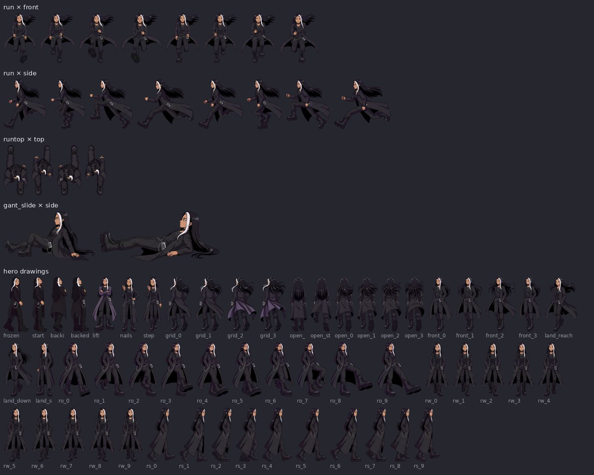

**Close-ups and plates** (`kits/noor/closeup/`; single drawings on the key colour, laid over a set whole). A plate with more than one of the cast is filed under each of them. Takes include rejected ones and expression edits; the sidecar `.json` beside each has its prompt.

| Plate | Takes | Kind | Shots that name it |
|---|---|---|---|
| `brk_face` | 5 | plate | `breakdown.js` |
| `brk_go` | 1 | plate | — |
| `core_face` | 4 | plate | `core.js`, `core_face.js` |
| `core_phones` | 6 | plate | — |
| `core_play` | 4 | plate | `core.js`, `core_play.js` |
| `fall_face_noor` | 4 | plate | — |
| `fall_side_noor` | 3 | plate | — |
| `gant_haul` | 3 | plate | `gant_haul.js`, `gantry.js` |
| `open_face` | 4 | close-up | — |
| `reun_eyes` | 2 | close-up | — |
| `reun_noor_edge` | 1 | plate | `reun_fight.js` |
| `reun_noor_over` | 1 | plate | — |
| `reun_noor_side` | 1 | plate | `reun_fight.js` |
| `reun_noor_walk` | 1 | plate | — |
| `reun_stop_noor` | 1 | plate | `reun_meet.js` |
| `slice_run` | 1 |  | `gant_out.js`, `slice.js`, `slice_faces.js`, `slice_run.js` |

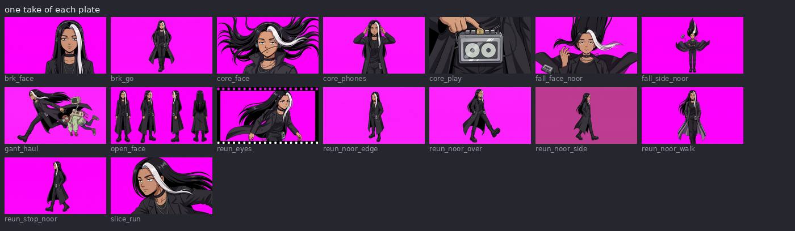

Also `kits/noor//`: drawings cut from plates for one section's shots (pipeline/sprites.py), 0 files.
<!-- /generated:noor -->

## The crowd

Background people for a set (`sets/market.js` stands them along the street): whole-figure drawings like the cast,
because procedural figures "looked non-human". Each has a calm drawing and a startled one that register to each
other, so a crowd can react on a frame.

<!-- generated:crowd -->
40 people, two drawings each (going about their business; startled), cut by `kits/crowd/cut.py` from sheets in `kits/crowd/source/`:

| Role | People |
|---|---|
| shopper | `vest`, `fitter`, `headphones`, `headscarf`, `poncho`, `coins`, `turban`, `mohawk`, `fish`, `moustache`, `duster`, `braid`, `docker`, `camcorder`, `backpack`, `shoulders`, `radio`, `walker`, `parasol`, `snacks`, `merchant`, `keytar`, `cable`, `monk`, `twins`, `robot`, `couple`, `courier`, `spacer`, `father` |
| keeper | `cook`, `tapes`, `fruit`, `mechanic`, `tea`, `solder`, `dumplings`, `cassettes` |
| special | `porter`, `sleeper` |

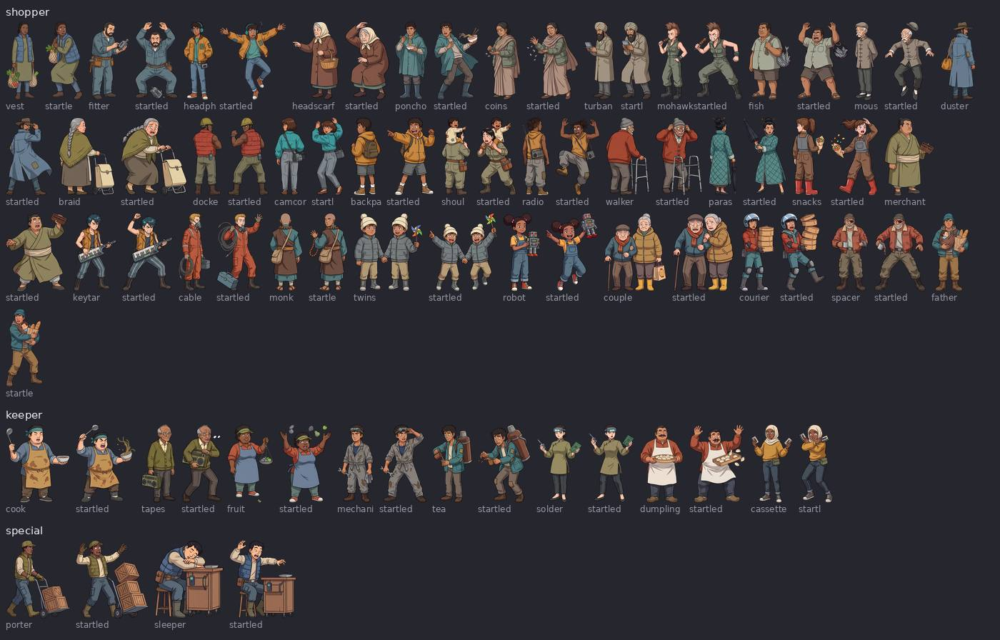

<!-- /generated:crowd -->

---

# Recipes for new drawings

These call the image model: they need `GEMINI_API_KEY` in `.env` and cost money per image. **They were not run
while writing this guide** (no images were generated); the commands are the ones the project's history used and each
script's header documents. The layout step and the checks need no key and were run.

Before any of them, read the rules about image generation in [CLAUDE.md](../CLAUDE.md) (6 to 13). The short of it:
all drawings of one action in ONE image; painted over a layout, not from a description; the model sheet shown with
"do not copy it"; never an accepted sheet as a reference; a person looks at every drawing that goes in.

## A new action for an existing character

1. **Pose it on the skeleton.** Add the action to `engine/actions.js` `ACTIONS` with a prefixed name (your section's:
   `mine_wave`): how many drawings, whether it loops, and a `pose(i, who)` returning each pose in joint angles
   (`pose({ lean, twist, head, arm: { L, R }, leg: { L, R } })`; the file has thirty examples with their intent in
   words). Mark a held pose `loose: true`. Add a line to the character's `character.json` `acting` saying how they
   do it in words.
2. **See the poses** before painting: `node render.mjs YOUR_SHOT.js --mannequin --frames ...`.
3. **Lay out the sheet**: the mannequins the drawings will be painted over, and where the skeleton is in each.

   ```sh
   node pipeline/layout.mjs juno mine_wave side            # -> kits/juno/source/mine_wave/side/layout.png, layout.json
   ```
4. **Paint, check and cut** (needs the key). It paints the whole action in one image, runs the checks, paints again
   on rejection (each rejection logged with its reasons), and cuts the first take that passes into the kit:

   ```sh
   .venv/bin/python pipeline/cels.py make juno mine_wave side --tries 3
   .venv/bin/python pipeline/cels.py check kits/juno/source/mine_wave/side/take_1.jpg     # the checks alone (6 s; no key)
   ```
5. **Look at it**, full size: `out/qc/juno_mine_wave_side.jpg` is the QC sheet. Then in motion on a plain backdrop:
   `node pipeline/proof.mjs YOUR_SHOT.js`. Then `node pipeline/check.mjs juno` and `npm run cast`.

Views: `side` is the character's LEFT side; do the views your cameras need (`front`, `front34`, `side`, `back34`,
`back`, `top`). One view of one action is one image.

## A drawing for one shot's camera (a hero cel)

When a shot needs a pose or an angle no view covers. The mannequin is the character exactly as the shot's camera
sees them on a frame, perspective included.

```sh
node pipeline/layout.mjs juno hero wave --shot stories/mine/shot.js --frames 7:wave_a,13:wave_b --what "she waves at the camera"
.venv/bin/python pipeline/cels.py make juno hero wave          # needs the key -> kits/juno/hero/wave_a.webp, wave_b.webp
```

The shot then says `{ who: "juno", action: ..., hero: "wave_a" }` on those frames. Several frames on one sheet stay
alike because they are one image. If the camera or the pose changes afterwards, the hero no longer fits:
`engine/motion.mjs` reports the angle.

## A close-up or a plate, and changes of expression

```sh
.venv/bin/python pipeline/plate.py mine_look juno "she looks up, startled, mouth a little open" --size 2K    # -> kits/juno/closeup/mine_look_1.jpg
.venv/bin/python pipeline/paint.py juno edit kits/juno/closeup/mine_look_1.jpg "her eyes are shut and she is laughing"   # -> mine_look_2.jpg
.venv/bin/python pipeline/match.py --register kits/juno/closeup/mine_look_1.jpg kits/juno/closeup/mine_look_2.jpg      # -> mine_look_2.png, graded and registered to the base
```

A change of expression is always an **edit of the accepted plate**, then `match.py`: two separately generated faces
never register. The shot swaps the base and the `.png` by frame ([shots.md](shots.md), `shots/brk_face.js`). Check
the whole picture after an edit, not just the face. `pipeline/sprites.py` cuts a plate and its edits into separate
drawings in one box when several figures are in one picture.

## Two characters touching

A grip, a haul, a hug: paint them **together in one plate**, so hands and holds are drawn, not overlapped.

```sh
.venv/bin/python pipeline/plate.py mine_haul noor,ife "Noor hauls Ife up by the wrist, both mid-stride"    # filed under both kits
```

Two cels on two skeletons can stand next to each other, pass, and overlap in depth; they cannot hold hands. For a
moment of contact inside a skeleton shot, cut to a plate for it (the film's `gant_haul`), or paint both as one hero
sheet. Figures that must match but do not touch (four faces in a row) are painted in one image, apart, and cut
with `pipeline/sprites.py --split`.

## A new character

1. **A sketch and a design in words.** Put an origin drawing anywhere in the repository (the cast's are in
   `art/cast/`). Copy a `kits/NAME/character.json` and rewrite it: `origin`, `style` (keep
   `art/ref/test_face.png` to match the cast), `body` (`height` in metres, `heads`; everything else has defaults),
   `describe` (`who`, a `design` list of plain items, and `never`: no logos, lettering or insignia), `acting`.
   Simplify: few flat colours, nothing asymmetric unless it must be, nothing that can wander.
2. **The model sheet** (needs the key): `.venv/bin/python pipeline/paint.py NAME design`. Look, reject, repeat;
   set `design` in `character.json` to the accepted sheet. Then fill in `palette` (the design's flat colours, read
   off the sheet), `wear` (which colours each body part may show), `flats`, so the checks can hold drawings to it.
3. **Check the mannequin fits the design**: `body.pad` and `body.extras` fatten the dummy where hair or a coat needs
   room. `node pipeline/layout.mjs NAME run side` and look at the layout.
4. **The run first**: `cels.py make NAME run side`, then `front`, then what your shots need. Run
   `cels.py selftest` on the first accepted sheet: it breaks the sheet every way the checks guard against and shows
   whether each is caught for this design (glasses, a long coat and a small profile face each needed a check loosened).
5. Add the character to `kits/cast.js` (kit path, colours, `LEGS`) and run `node pipeline/check.mjs NAME`, `npm run cast`, `npm test`.

Expect to throw away about four drawings in ten. Budget for it, log every rejection (`paint.py NAME reject FILE
"why"`), and fix the prompt or the pipeline when the same thing is rejected twice.

## Commands that need no key

```sh
npm run cast                                    # regenerate this file's tables and docs/img/ from the kits (27 s)
node pipeline/check.mjs juno                    # the kit against the engine
node pipeline/layout.mjs juno idle front --out try      # a layout sheet (writes kits/juno/source/idle/front/try.*)
.venv/bin/python pipeline/paint.py juno count   # generations made and rejected, with reasons, from the log
.venv/bin/python pipeline/cels.py check kits/juno/source/run/side/take_9.jpg     # judge a take against its layout
```
